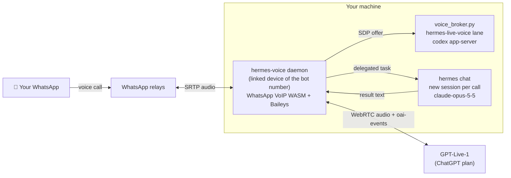

# hermes-whatsapp-voice 📞

**Call your [Hermes agent](https://github.com/NousResearch/hermes-agent) on WhatsApp.**
Ring your bot's WhatsApp number and the call is picked up by a full-duplex **GPT-Live-1** voice (the
same persona as the [hermes-live-voice](https://github.com/Synero/hermes-live-voice) desktop mic).
Anything that needs real work is handed to a **new Hermes chat** opened for that call, pinned to the
model you choose (Claude Opus 5.5 by default). The answer is read back to you on the call.

```
You: "What's on my to-do list?"
Hermes (voice): "Let me check your to-do list."
        └─▶ new Hermes chat "WhatsApp call Alex 25 Sep, 19:03" (claude-opus-5-5) → read_file → answer
Hermes (voice): "You have twelve open items. The top three are…"
```

It also places **outbound** WhatsApp calls that speak a message (TTS or an audio file).

> ⚠️ Unofficial. This drives WhatsApp Web's own VoIP WebAssembly stack through
> [Baileys](https://github.com/WhiskeySockets/Baileys). It can break whenever WhatsApp Web changes,
> and automated use can get the number banned. Use a number you can afford to lose, and only call
> people who agreed to it. Not affiliated with WhatsApp/Meta, OpenAI or Nous Research.

## How it works



1. The daemon runs as its own **linked device** (like WhatsApp Web) of the bot number and keeps a
   Baileys socket open. When an allowlisted number calls, it accepts the call with the WhatsApp Web
   VoIP WASM stack.
2. At the same moment it opens a WebRTC session to **GPT-Live-1** through the hermes-live-voice
   plugin's Codex Live lane (`codex app-server`, ChatGPT subscription). It reuses that plugin's
   persona, `SOUL.md`, memory snapshot and voice delegation policy, so a phone call behaves like the
   desktop mic.
3. Audio is bridged both ways: caller audio (16 kHz PCM from the WASM) goes to the model, and the
   model's audio track is resampled from 48 kHz to 16 kHz back into the call. Barge-in is supported.
4. When the voice model delegates a task (`delegation.created`), the daemon runs it in a Hermes chat
   created for the call (`hermes chat --format stream-json -m <model> --provider <provider>`).
   Follow-up tasks in the same call resume that chat. The result goes back through
   `delegation.context.append` and is spoken. If you hang up first, the result is sent to you as a
   WhatsApp message.
5. Say "bye" and it says goodbye and hangs up. Idle calls and very long calls are ended
   automatically.

## Requirements

- macOS (tested) or Linux, Node.js ≥ 20, `ffmpeg` on `PATH` (macOS `say` for text-to-speech on
  outbound calls)
- [Hermes Agent](https://github.com/NousResearch/hermes-agent) with the
  [hermes-live-voice](https://github.com/Synero/hermes-live-voice) plugin installed
  (`hermes plugins install hermes-live-voice`, lands in `~/.hermes/plugins/talk-desktop`)
- `codex` CLI ≥ 0.154 logged in with a ChatGPT plan (`codex login`). The voice uses the plan's
  voice allowance.
- A WhatsApp number for the bot, on a phone that can add linked devices

## Install

```bash
git clone https://github.com/ajaygahlot8/hermes-whatsapp-voice
cd hermes-whatsapp-voice
npm install
npm run fetch-wasm      # downloads WhatsApp Web's VoIP WASM (not redistributed here), checks SHA-256
npm run build
```

### Link the bot number (once)

```bash
node bin/hermes-call.mjs link 9199XXXXXXXX     # the bot's number, country code first
```

On the bot's phone: **WhatsApp → Settings → Linked devices → Link a device → Link with phone number
instead**, then type the 8-character code. A new code is issued automatically if one expires. The
session is stored in `~/.hermes/platforms/whatsapp/caller-session`. Treat it like a password, and
never point it at the Hermes gateway's own `session/` folder: two sockets on one set of credentials
kick each other off.

### Configure

Settings are read from `~/.hermes/.env` (see [`.env.example`](.env.example)). Callers come in three
tiers, identified by the caller ID WhatsApp verifies:

| Tier | Where it's set | Voice knows your memory | Can run tasks | Personal info |
|---|---|---|---|---|
| **Verified** (you, household) | `WHATSAPP_VOICE_ALLOWED`, or `"verified": true` in the callers file | yes | yes | yes |
| **Known** (family, friends) | callers file | no | yes (unless `"tasks": false`) | no |
| **Stranger** | only with `WHATSAPP_VOICE_ANSWER=everyone` | no | no (unless `WHATSAPP_VOICE_UNKNOWN_TASKS=1`) | no |

```bash
WHATSAPP_VOICE_ALLOWED=9198XXXXXXXX:Alex        # verified: numbers (or <lid>@lid) with a name
WHATSAPP_VOICE_ANSWER=everyone                  # also pick up strangers (default: known callers only)
```

Per-caller settings go in `~/.hermes/whatsapp-voice-callers.json`:

```json
{
  "callers": [
    { "name": "Sam", "number": "9198XXXXXXXX", "verified": true },
    { "name": "Papa", "number": "9199XXXXXXXX", "language": "hi",
      "note": "He is Alex's father. Talk with him in simple, respectful Hindi and be patient." }
  ]
}
```

`language` (`en`, `hi`, `es`, … or `auto`) sets the language the voice speaks from its first words.
`note` tells the voice and the task chat who the caller is. After a stranger's call, the owner (the
first `WHATSAPP_VOICE_ALLOWED` number) gets a WhatsApp text with the transcript.

| Variable | Default | Meaning |
|---|---|---|
| `WHATSAPP_VOICE_ALLOWED` | *(empty)* | Verified callers: comma list of `number[:Name]` or `<lid>@lid[:Name]` |
| `WHATSAPP_VOICE_ANSWER` | `allowlist` | `everyone` also answers strangers (conversation only) |
| `WHATSAPP_VOICE_UNKNOWN_TASKS` | `0` | `1` lets strangers run tasks too. **Not recommended**: tasks run with your agent's tools |
| `WHATSAPP_VOICE_CALLERS_FILE` | `~/.hermes/whatsapp-voice-callers.json` | Per-caller name, tier, language and note |
| `WHATSAPP_VOICE_OWNER` | first allowlisted number | Who gets the transcript of strangers' calls |
| `WHATSAPP_VOICE_NOTIFY_OWNER` | `1` | `0` turns those transcripts off |
| `WHATSAPP_VOICE_CHAT_MODEL` | `claude-opus-5-5` | Model for the per-call Hermes chat |
| `WHATSAPP_VOICE_CHAT_PROVIDER` | `anthropic` | Provider for that chat |
| `WHATSAPP_VOICE_VOICE` | `cove` | GPT-Live-1 voice: cove, juniper, maple, spruce, ember, vale, breeze, arbor, sol |
| `WHATSAPP_VOICE_LANGUAGE` | `en` | Default language: `en`, `hi`, `es`, …, or `auto` (follow the caller) |
| `WHATSAPP_VOICE_PROFILE` | *(host identity)* | Hermes profile whose `SOUL.md` the voice adopts |
| `WHATSAPP_VOICE_ANSWER_DELAY_MS` | `1500` | Minimum ring time before answering |
| `WHATSAPP_VOICE_TASK_WAIT_S` | `150` | How long the voice waits for a task before saying "still working" |
| `WHATSAPP_VOICE_IDLE_HANGUP_S` | `180` | Hang up after this much silence (never while a task runs) |
| `WHATSAPP_VOICE_MAX_CALL_MIN` | `30` | Hard call limit (protects the voice allowance) |
| `WHATSAPP_VOICE_LATE_RESULT_TEXT` | `1` | Send results that finish after hang-up as a WhatsApp message |
| `WHATSAPP_VOICE_BARGE_RMS` | `0.04` | Caller loudness that interrupts the bot mid-sentence |
| `WHATSAPP_VOICE_CONTROL_PORT` | `3910` | Loopback control API port |
| `WHATSAPP_VOICE_DEBUG` | `0` | `1` logs WhatsApp signaling and WASM internals |
| `WHATSAPP_CALLER_AUTH` | `~/.hermes/platforms/whatsapp/caller-session` | Linked-device session folder |
| `WHATSAPP_CALLER_VOICE` | `Samantha` | macOS `say` voice for outbound message calls |
| `WHATSAPP_CALLER_RING_TIMEOUT_MS` | `45000` | Outbound ring timeout |

### Run

```bash
npm start                      # foreground; logs to stdout
node scripts/install-launchd.mjs   # macOS: install as a LaunchAgent (auto-start, restart on crash)
```

Logs: `~/.hermes/logs/whatsapp-voice.log`. Status: `curl http://127.0.0.1:3910/status`.

<details><summary>Linux (systemd user service)</summary>

```ini
# ~/.config/systemd/user/hermes-whatsapp-voice.service
[Service]
WorkingDirectory=%h/hermes-whatsapp-voice
ExecStart=/usr/bin/node hermes-voice/daemon.mjs
Restart=on-failure
[Install]
WantedBy=default.target
```
`systemctl --user enable --now hermes-whatsapp-voice`
</details>

### Self-test (no WhatsApp needed)

```bash
npm run selftest
```

Speaks a synthetic question into a real GPT-Live-1 session. It checks the transcript and the
delegation to a Hermes chat, and writes the bot's reply audio to `/tmp/hermes-voice-selftest.wav`.

## Outbound message calls

```bash
node bin/hermes-call.mjs call 9198XXXXXXXX "Hi, this is Hermes. Your parcel has arrived."
node bin/hermes-call.mjs call 9198XXXXXXXX ./message.mp3
```

Prints `{"to","answered","reason"}`. Exit code 0 means answered and played, 2 means not answered.
When the daemon is running, the call goes through it (`POST /call`), so the linked device keeps a
single connection.

## What this adds to baileys-caller

`src/` is [SheIITear/baileys-caller](https://github.com/SheIITear/baileys-caller) (outbound-only)
extended with **incoming calls**:

- Incoming `<offer>` stanzas are screened (`screenIncomingCall`) before the WASM sees them, so calls
  you don't answer keep ringing on the phone as usual.
- **LID caller fix**: WhatsApp sends `call-creator="<lid>@lid"`. Re-encoded as a JID pair, the WASM
  reads it as `s.whatsapp.net` and drops the offer ("mismatched peer id and creator id"). It is
  rewritten to the device form `<lid>:0@lid`, which is encoded as an AD-JID the WASM reads
  correctly.
- `call.accept()` / `call.reject()` through the WASM's `acceptCall` / `rejectCall`, after the
  `ReceivedCall` state.
- WASM event `2` is "offer received", not "remote hang-up" (upstream treated it as an end, which
  kills incoming calls).
- A push-mode uplink (`call.pushAudio(pcm16k)`) with a real-time paced feeder, and a downlink
  playback loop paced at the codec's frame interval that also emits silence (a continuous stream
  for speech models).
- Local hang-ups finish cleanly even when the WASM never reports the end.

## Security notes

- Tasks run in a local Hermes chat, and a Hermes chat started from the CLI trusts its user like the
  owner. So only verified and known callers can delegate by default, and every task prompt states
  who is really calling and that non-verified callers must not get personal information.
- Only verified callers get a voice persona with your memory (`USER.md`, `MEMORY.md`, Mnemosyne).
  Everyone else gets a persona without it, so the voice itself has nothing private to leak.
- The per-call chat is told to ask before anything irreversible or outward-facing (send, post,
  delete, pay, merge), and to act on the most likely intent of a possibly mis-heard request.
- The control API binds to `127.0.0.1` only and refuses requests with an `Origin` header or a
  foreign `Host`.
- The linked-device session folder is a credential. libsignal's session dumps (which include
  private keys) are filtered out of the logs.

## Limitations

- 1:1 audio calls only: no group calls or video. One call at a time; a second caller rings the
  phone normally.
- Hermes turns are separate processes (about 4 s cold start per task). The voice fills the wait
  ("let me check…").
- GPT-Live-1 minutes come from your ChatGPT plan's voice allowance.

## Credits

- [SheIITear/baileys-caller](https://github.com/SheIITear/baileys-caller) (MIT): WhatsApp Web VoIP
  WASM wrapper and signaling, the base of `src/`
- [Synero/hermes-live-voice](https://github.com/Synero/hermes-live-voice) (MIT): the GPT-Live-1 /
  Codex Live lane, persona and delegation policy reused at runtime
- [WhiskeySockets/Baileys](https://github.com/WhiskeySockets/Baileys),
  [@roamhq/wrtc](https://github.com/WonderInventions/node-webrtc),
  [NousResearch/hermes-agent](https://github.com/NousResearch/hermes-agent)

## License

MIT, see [LICENSE](LICENSE) and [NOTICE.md](NOTICE.md). WhatsApp's WASM assets are not part of this
repository or its license; `npm run fetch-wasm` downloads them on your machine.
